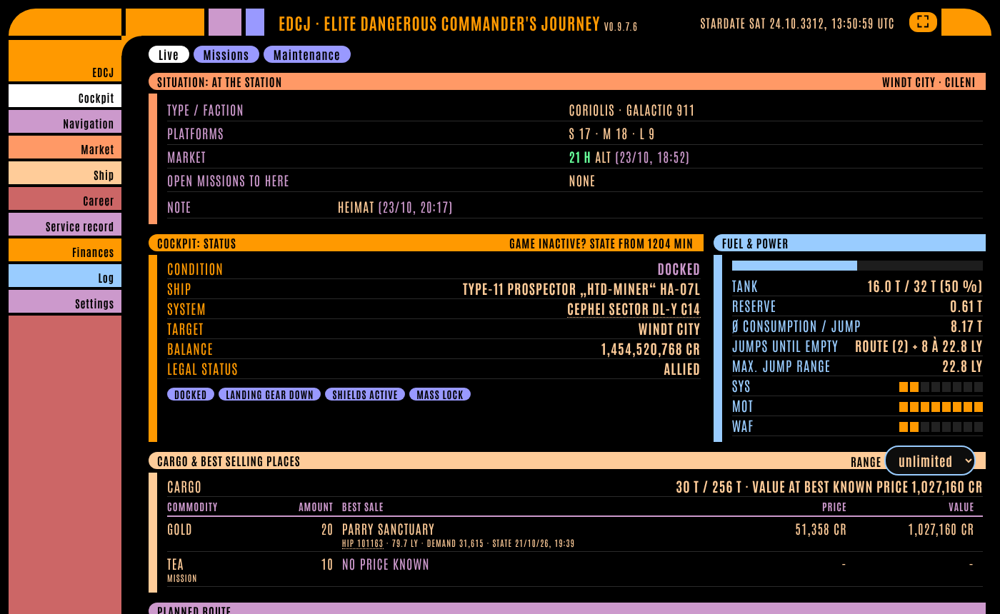
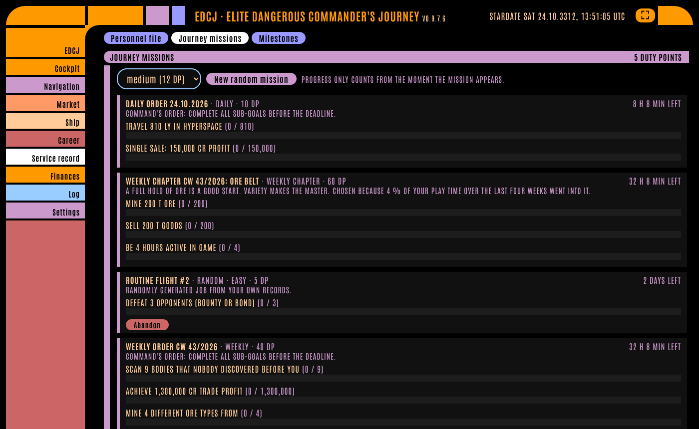
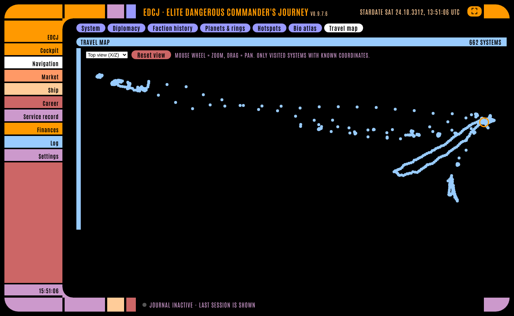
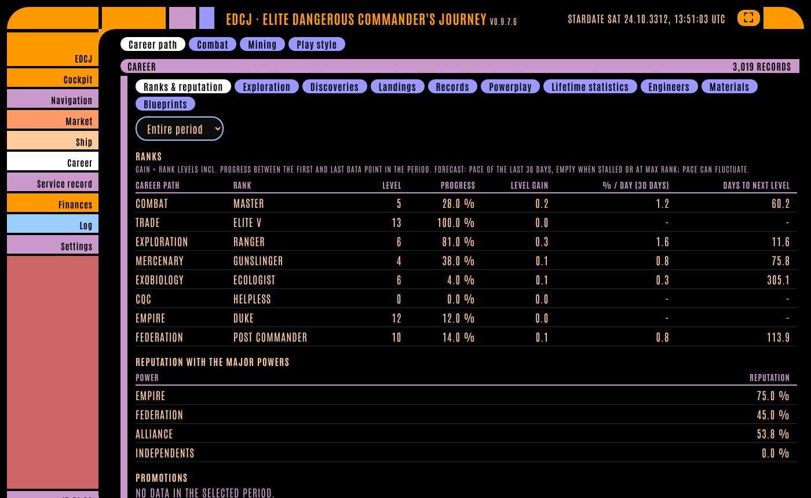
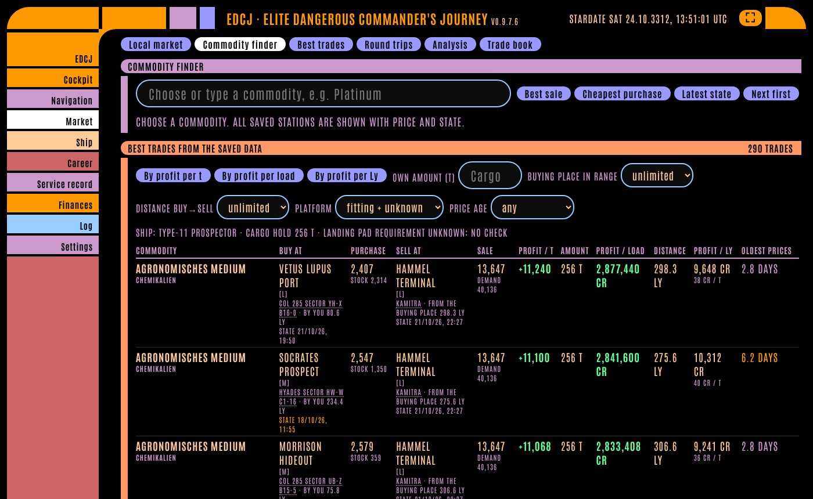

# EDCJ – Elite Dangerous Commander's Journey

A local companion for **Elite Dangerous**: it reads your game journal and shows your career, markets, ships, exploration, missions and play style in a web interface in the LCARS look (other themes available). Python 3 only, no extra packages.

*Deutsch: [README.de.md](README.de.md) · Manuals (PDF): [English](docs/EDCJ-Manual-EN.pdf) · [Deutsch](docs/EDCJ-Handbuch-DE.pdf)*

> **Unofficial fan project.** EDCJ is not affiliated with, endorsed by or connected to Frontier Developments. Elite Dangerous is a trademark of Frontier Developments plc.

## Quick start

You do not need to set or enter anything. All start parameters are optional.

1. **Linux:** `python3 edcj.py` in the program folder.
   **Windows 10/11:** install [Python 3](https://www.python.org/downloads/) (tick "Add python.exe to PATH"), then double-click `EDCJ-Start.bat`.
2. Your browser opens by itself. Done.

The journal folder is found automatically (Steam/Proton, Flatpak, Lutris, Wine, Windows "Saved Games"). Only for an unusual path use `-d "path"`. Your data is stored in the `data/` folder next to the program.

## Features

- **Cockpit:** live situation, fuel and jump range, cargo with best selling places, planned route, credits per hour, pre-flight maintenance (fuel, hull, modules, ammo, rebuy).
- **Navigation:** system overview with factions, rings and hotspots, bodies, bio atlas, faction history, travel map.
- **Market:** local market, commodity finder, best trades and round trips from the markets *you* visited, trade book.
- **Ship:** equipment for sale at visited stations, fleet with loadouts and side-by-side ship comparison, fleet carrier.
- **Career:** ranks and reputation, exploration and discoveries (with value estimate), landings, records, Powerplay, engineers, materials, blueprints, combat, mining, play style.
- **Service record:** Journey missions (daily, weekly, monthly, random, weekly chapters) generated from your own play, ranks and milestones.
- **Log:** automatic Captain's Log, search, notes, gallery for screenshots, flight recorder.
- **Tablet / second screen:** optional access from your home network, fullscreen mode, set a course from the tablet.
- **Languages:** German and English (Settings), several themes.

| | |
|---|---|
|  |  |
|  |  |

## Privacy

- EDCJ **sends nothing to the internet**: not to Inara, not to any other service, and it does not use the Frontier CAPI. The interface loads no external fonts, scripts or images.
- It only evaluates **your own journal files** and never changes them. Nothing is invented or guessed: values the journal does not contain (e.g. shield strength) are not shown.
- Markets and shipyards are only known for stations that appear in your journals or market files.
- Tablet access is **off by default**. When enabled, it needs an access code and is meant for your home network only – do not expose EDCJ to the internet.

## Your data and updates

- Everything lives in `data/` next to `edcj.py` (`market.db`, `captains_log.md`, settings, screenshot copies). Back it up in Settings → "Save backup".
- **Update:** unzip the new version over the old folder (`data/` stays), restart, press Ctrl+F5 in the browser. After some updates EDCJ rebuilds its database once from your journals.
- **About history:** on the very first start only the *last play session* is written into the Captain's Log (the text file). Career, play style, records, factions, bodies and scans are read from *all* journals found. For more old sessions in the log, start once with `--backfill 50` (log only, first start only).

## Start parameters (all optional)

| Parameter | Meaning |
|---|---|
| `-d FOLDER` | journal folder, if it is not found automatically |
| `--port N` | port of the interface (default 8800) |
| `--lan` | share on the home network for a tablet (access code required) |
| `--app` | open as app window (Chromium-based browsers) |
| `--no-browser` | do not open the browser automatically |
| `--backfill N` | on the first start, also write N older journals into the Captain's Log |
| `--log PATH` | location of the Captain's Log (and thus the data) |

## Tablet and home network

1. Switch on sharing in Settings → "Tablet & home network" (or start with `--lan`) and restart EDCJ.
2. Open the shown address (e.g. `http://192.168.178.25:8800/`) in the tablet's browser and enter the access code once. The PC itself needs no code.
3. Backup, restore and shutdown only work on the PC. Five wrong codes lock access for a minute.
4. Windows asks about the firewall on first start: allow "Private networks". Linux with ufw: `sudo ufw allow from 192.168.0.0/24 to any port 8800 proto tcp` (adjust the network).

## Development

Pure Python standard library (`http.server`, `sqlite3`), vanilla JavaScript. Modules live in `journey/`, the interface in `web/`. See [README.de.md](README.de.md) ("Aufbau", "Erweitern") for a module overview. Contributions and bug reports are welcome – please attach no personal data (journals, `data/`).

## License

[MIT](LICENSE) © 2026 HamWlad. The bundled font *Antonio* is licensed under the SIL Open Font License 1.1 (`web/fonts/OFL.txt`).
